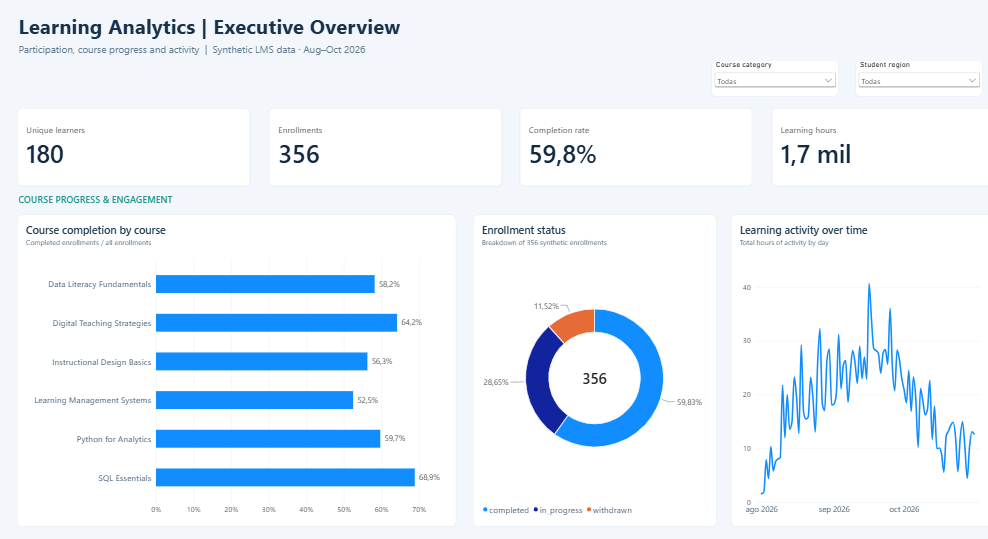
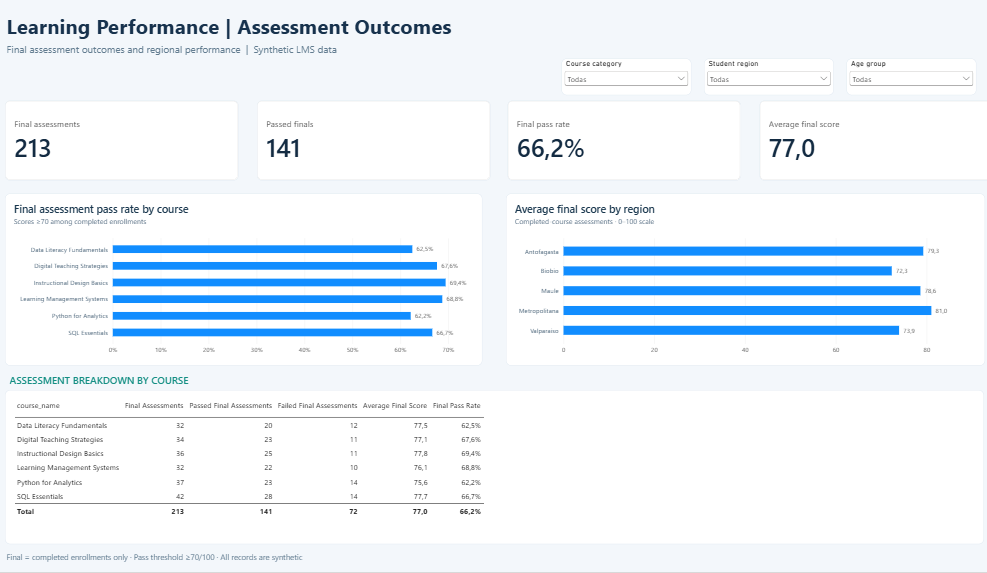

# Learning Analytics Portfolio 📊 🎓

**SQL · Python · SQLite · Learning Analytics · EdTech**

A reproducible portfolio project showcasing analytics workflows for a fictional Learning Management System (LMS). It generates synthetic training data, models relational tables, calculates educational KPIs with SQL, and exports both CSV reports and a browser-ready HTML dashboard.

> **Data ethics:** All learner, enrollment, activity and assessment records are synthetic. No proprietary code or real student/employer data is included. This is a demonstration project, not a production LMS.

## Dashboard preview

### Executive Overview — Power BI Desktop

### Learning Performance — Power BI Desktop

**Screenshots from Power BI Desktop (November 2026).** This Power BI demonstration uses entirely synthetic LMS data. The frozen Power BI dataset contains **180 enrolled learners, 356 enrollments, 213 completed enrollments and a 59.8% completion rate**. The Python/SQLite example is generated separately and uses a different synthetic fixture.

After running the project, open **reports/dashboard.html** in any browser. The dashboard shows enrollments, learners, completions and course-level completion rates. No paid services, external APIs or third-party Python packages are required.

## Quick start

Requirements: **Python 3.11+**

~~~bash
git clone https://github.com/merbyn-gomez/learning-analytics-portfolio.git
cd learning-analytics-portfolio
python src/learning_analytics.py all
~~~

Outputs (created locally; intentionally excluded from version control):

- **data/learning_analytics.sqlite** — relational SQLite database
- **reports/01_overview.csv** — overall enrollment and completion indicators
- **reports/02_course_performance.csv** — completion by course
- **reports/03_engagement.csv** — active enrollments and engagement hours
- **reports/04_assessments.csv** — evaluation results and pass rates
- **reports/dashboard.html** — lightweight visual dashboard

Run the automated checks:

~~~bash
python -m unittest discover -s tests -v
~~~

## Data model

- **students:** region and age group (320 fictional learners)
- **courses:** six fictional Data and Education courses
- **enrollments:** course assignments and completion status
- **activities:** learning events with dates and duration
- **assessments:** illustrative evaluation scores (0–100)

The schema is defined in **sql/schema.sql**. Queries are individually version-controlled in **sql/queries/**.

## KPI definitions

| Metric | Definition |
| --- | --- |
| Enrollment completion % | Completed enrollments divided by all enrollments (including withdrawn) |
| Unique learners | Distinct students with at least one enrollment |
| Active enrollments (30d) | Distinct enrollments with an activity event between 2 and 31 October 2026 |
| Engagement hours (30d) | Total minutes spent on those activities divided by 60 |
| Assessment pass % | Final assessments from completed enrollments scoring at least 70 / all final assessments |

**Analytical limitations:** Activity events are simulated, not actual xAPI/SCORM events. This fixed-date demonstration is not a prediction of learner performance. Scores and thresholds are illustrative, not actual institution policies.

## Tech stack

Python standard library (sqlite3, csv, random, datetime, pathlib, unittest), SQL (SQLite), and a self-contained HTML/CSS dashboard.

## Future improvements

- Further develop retention/cohort analysis and learner outcome explanations
- Cohort retention and learning-path analysis
- Data-quality checks and a semantic KPI dictionary
- LMS event ingestion with an anonymized schema

---

## Español

**Portafolio de analítica del aprendizaje** que demuestra integración de datos educativos, modelado relacional, consultas SQL, indicadores de desempeño y generación de un tablero HTML. Todos los registros son **sintéticos**: no contienen información de estudiantes ni empleadores reales.

Para ejecutarlo instala Python 3.11 o superior y ejecuta:

~~~bash
python src/learning_analytics.py all
~~~

Abre **reports/dashboard.html** para visualizar los indicadores. Para ejecutar las pruebas:

~~~bash
python -m unittest discover -s tests -v
~~~

**Definición clave:** la tasa de finalización es el número de inscripciones completadas dividido entre todas las inscripciones, incluidas las retiradas. Los indicadores corresponden a datos ficticios con fecha de corte del 31 de octubre de 2026.

---

Portfolio maintained by **Merbyn Gómez Rondón**, focused on Data & Automation and Educational Technology.

## Power BI dashboard (editable PBIP)

A complete editable Power BI report source is available in **[powerbi/](powerbi/README.md)**. It includes a five-table semantic model, DAX measures, category and region filters, and two report pages backed by a synthetic public CSV snapshot. Open `powerbi/LearningAnalytics.pbip` in Power BI Desktop. Both PBIP report pages and their visuals were opened successfully in Power BI Desktop (owner-confirmed in November 2026). Both pages are shown above using actual Power BI Desktop screenshots, provided by the project owner.
